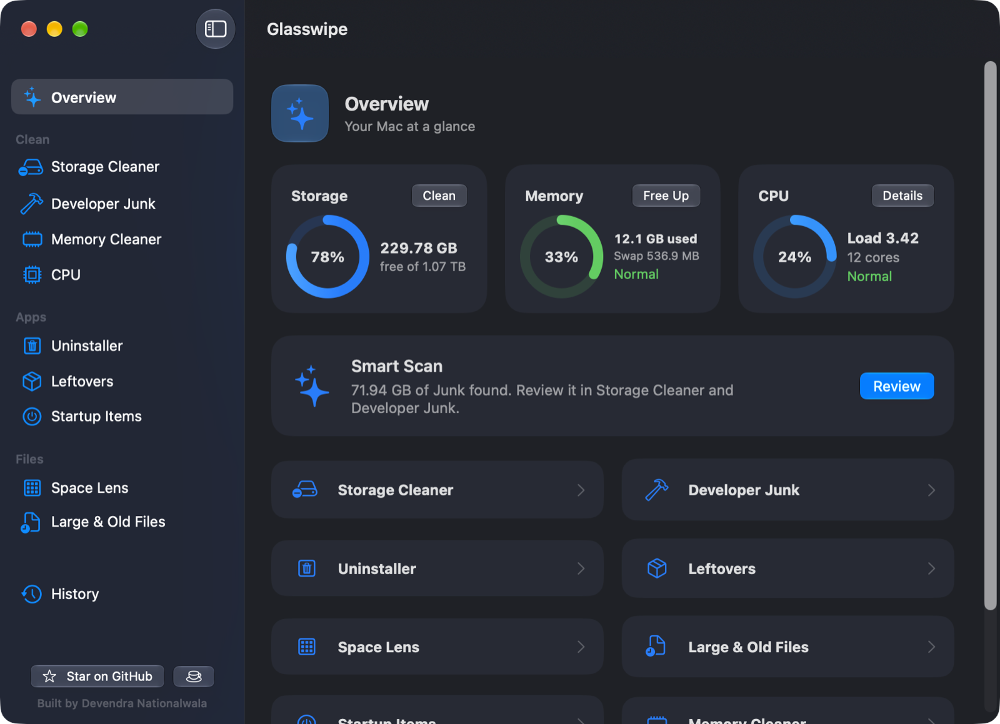
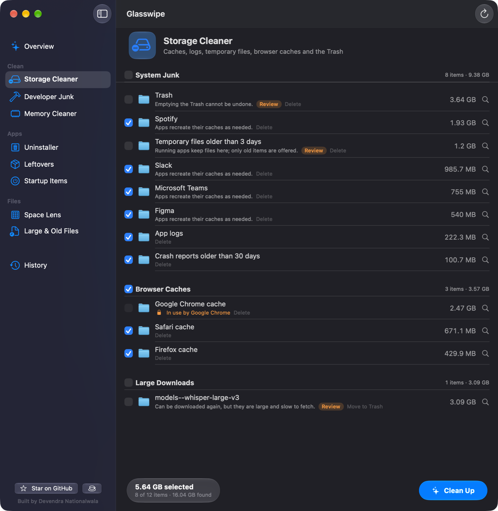
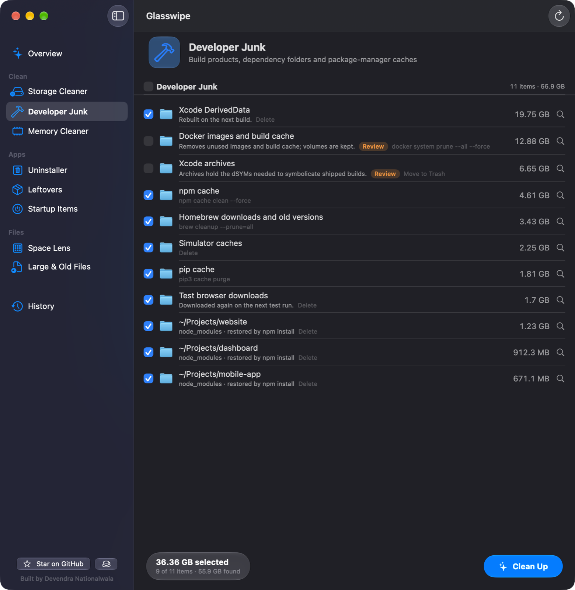
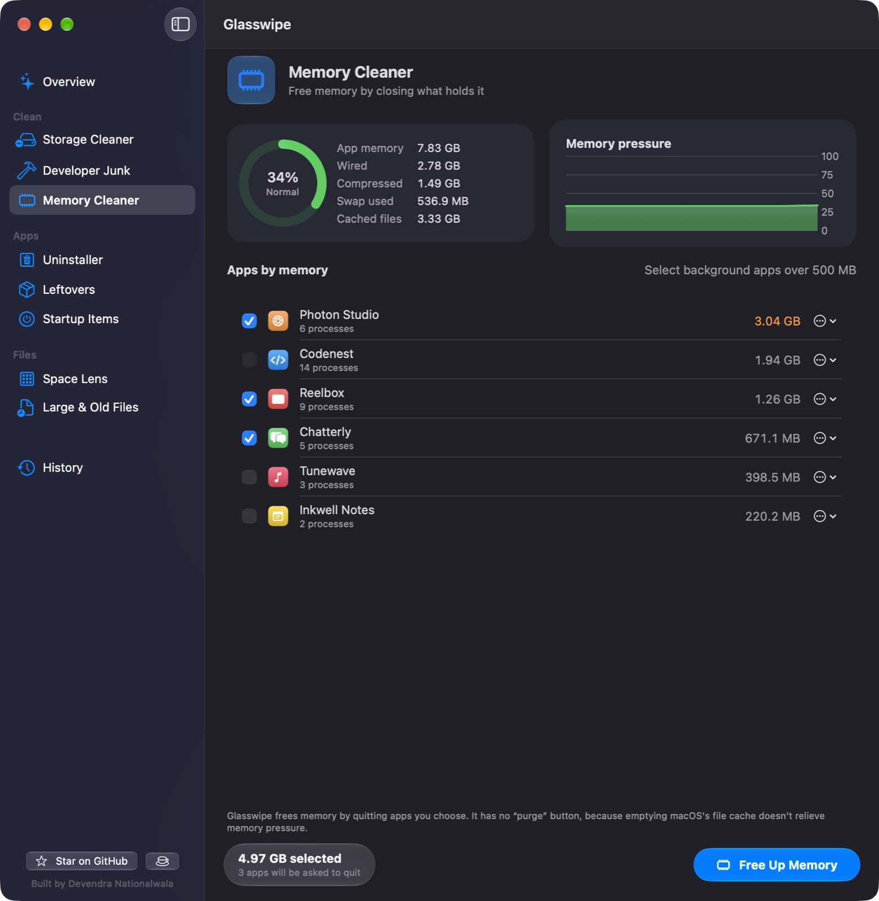
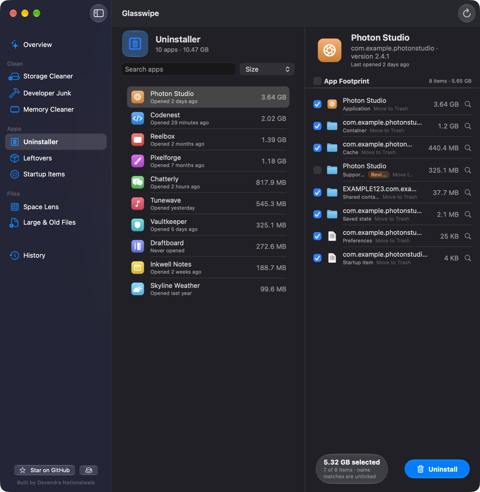
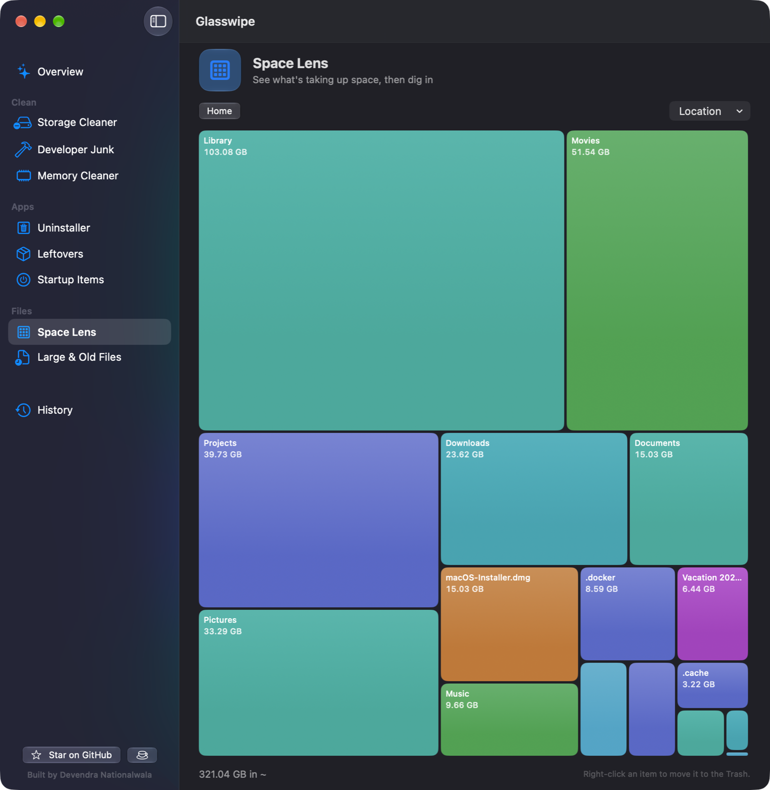

<div align="center">

# Glasswipe

**A free, open-source Mac cleaner with a native Liquid Glass design.**
Clear out Junk, free up memory, and uninstall apps along with everything they leave behind.

[**⬇ Download Glasswipe for macOS**](https://github.com/devendra-nationalwala/glasswipe/releases/latest/download/Glasswipe.dmg)

macOS 26 (Tahoe) or later · Apple Silicon · [All releases](https://github.com/devendra-nationalwala/glasswipe/releases) · [MIT License](LICENSE) · [☕ Buy me a coffee](https://donate.stripe.com/4gMdRa8GPapX8oSgoO8og01)



</div>

> [!CAUTION]
> **Use at your own risk.** Glasswipe deletes files, moves files to the Trash, quits apps and changes startup settings on your Mac. The authors and contributors are **not responsible for any data loss, deleted files, damage or other consequences** of using it. Always review what is selected before cleaning up, and keep a current backup (for example Time Machine). See the [full disclaimer](#disclaimer).

## What it does

| | |
|---|---|
| **Storage Cleaner** | Finds caches, logs, temporary files, browser caches and the Trash that are safe to remove. |
| **Developer Junk** | Clears Xcode build data, `node_modules`, and caches from npm, pip, uv, Homebrew, Docker and more, using each tool's own clean command. |
| **Memory Cleaner** | Shows real memory pressure and frees memory by quitting the apps you choose. No fake "RAM boost". |
| **Uninstaller** | Removes an app together with its preferences, caches, containers and startup items. |
| **Leftovers** | Finds files left behind by apps you already deleted. |
| **Space Lens** | A map of what is taking up your disk. Click to dig into any folder. |
| **Large & Old Files** | Finds big or long-forgotten files in your folders. |
| **Startup Items** | Turn background agents on or off, and remove broken ones. |
| **Menu bar monitor** | Memory, CPU, disk and battery at a glance, with quick actions. |
| **History** | Everything Glasswipe has removed, and how much space it freed. |

## Screenshots

**Storage Cleaner:** every item is reviewed before anything is removed. Safe items start ticked; anything that can't be recreated is marked *Review* and starts unticked.


**Developer Junk:** build products and package caches, cleaned with each tool's own command.


**Memory Cleaner:** apps grouped with their helper processes, sorted by how much memory they really use.


**Uninstaller:** the app and every file it created, matched by its exact identifiers.


**Space Lens:** see at a glance where your space went.


## Install

1. **[Download Glasswipe.dmg](https://github.com/devendra-nationalwala/glasswipe/releases/latest/download/Glasswipe.dmg)** and open it.
2. Drag **Glasswipe** onto the **Applications** folder.
3. Open Glasswipe from Applications. macOS will say it **can't verify the developer**. This is expected: Glasswipe is free open-source software and is not notarized by Apple.
4. Open **System Settings → Privacy & Security**, scroll down, click **Open Anyway** next to Glasswipe, and confirm. You only need to do this once.
5. In Glasswipe, click **Open Settings** on the orange banner and switch on **Glasswipe** under **Full Disk Access**. Then click **Check Again**.

By installing or running Glasswipe you accept the [disclaimer](#disclaimer).

<details>
<summary>Prefer the Terminal for step 4?</summary>

```bash
xattr -dr com.apple.quarantine /Applications/Glasswipe.app
```

This removes the "downloaded from the internet" flag so macOS opens the app without asking.
</details>

<details>
<summary>Build it yourself instead</summary>

You need full Xcode. Then:

```bash
git clone https://github.com/devendra-nationalwala/glasswipe.git
cd glasswipe
scripts/create-signing-identity.sh
scripts/build-app.sh --install
```

See [CONTRIBUTING.md](CONTRIBUTING.md) for details.
</details>

## Using Glasswipe

1. **Start with Overview → Smart Scan.** It scans System Junk and Developer Junk in one go and shows how much it found.
2. **Review.** Each module lists what it found, grouped and sized. Untick anything you want to keep, or click 🔍 to see it in Finder. Results appear while the Scan is still running. Don't want to wait? Click **Stop & Review** to clean up what has been found so far; the next Scan picks up the rest.
3. **Clean Up.** A confirmation tells you exactly what will be deleted, what goes to the Trash, which tools will clean themselves, and whether your password is needed.
4. **Changed your mind?** Anything moved to the Trash can be put back from the Trash. **History** lists everything that was removed.

**To uninstall an app:** open **Uninstaller**, pick the app, check the list of files, and click **Uninstall**. The app is quit first if it's running.

**To free memory:** open **Memory Cleaner**, tick the apps you can close (or click *Select background apps over 500 MB*), and click **Free Up Memory**. Apps are asked to quit normally, so they can save your work.

**Menu bar:** Glasswipe keeps running in the menu bar after you close its window. Click the ✨ icon for live stats and quick actions; choose **Quit** there to exit completely.

**Settings** (⌘,): check Full Disk Access, turn the critical-memory notification on or off, and add **Exclusions**: folders Glasswipe will never scan or touch.

## How Glasswipe keeps your files safe

- **Nothing is removed without your review.** Every module scans first, shows what it found, and asks before cleaning up.
- **Safe items are pre-selected; anything that can't be recreated is unticked.** In the Uninstaller, files matched only by name are opt-in. Every Leftover is opt-in.
- **Recreatable Junk is deleted; everything else goes to the Trash**, so you can put it back.
- **Tools clean themselves.** Homebrew, npm, pip, uv, Docker and others are cleaned with their own commands, never by deleting their files.
- **A Safety Gate checks every path** and refuses system folders, your top-level folders (Documents, Desktop, …), whole app containers and Docker's disk image. If its rules fail to load, nothing can be removed.
- **Caches of running apps are skipped.** Browser caches are offered only while the browser is closed.
- **Leftovers are conservative.** Files count as Leftovers only when no installed app comes from the same developer. Apple and system files never do.
- **Everything is logged** to `~/Library/Logs/Glasswipe/cleanup.jsonl` and shown in History.
- **No internet connection.** Glasswipe works entirely on your Mac; it sends nothing anywhere.

## FAQ

<details>
<summary><b>macOS says Glasswipe "can't be opened" or "is damaged".</b></summary>

That is Gatekeeper blocking an app that isn't notarized by Apple. Use **System Settings → Privacy & Security → Open Anyway**, or run `xattr -dr com.apple.quarantine /Applications/Glasswipe.app` in Terminal.
</details>

<details>
<summary><b>Why does it need Full Disk Access?</b></summary>

macOS hides the Trash, Safari, Mail, iOS backups and other apps' data from every app unless you allow it. Without Full Disk Access, Glasswipe still works but skips those locations.
</details>

<details>
<summary><b>Why does it sometimes ask for my password?</b></summary>

Only when you clean system-wide folders (like `/Library/Caches`), change system-wide startup items, or uninstall an app owned by the system. macOS asks once per Cleanup. Glasswipe never stores your password.
</details>

<details>
<summary><b>Full Disk Access stopped working after an update.</b></summary>

macOS ties the permission to the app's signature. If an update was signed differently, switch Glasswipe off and on again under Full Disk Access.
</details>

<details>
<summary><b>Why is the Developer Junk scan slow?</b></summary>

Package caches such as uv or npm can hold millions of tiny files, and measuring them takes time. Results appear while the rest is still being measured.
</details>

<details>
<summary><b>Why doesn't Startup Items list the apps that open at login?</b></summary>

macOS only lets administrators read that list. Glasswipe shows background agents and daemons, and the **Open Login Items Settings** button takes you to the system list.
</details>

<details>
<summary><b>How do I remove Glasswipe?</b></summary>

Quit it from the menu bar, then drag `/Applications/Glasswipe.app` to the Trash. Optionally delete `~/Library/Logs/Glasswipe` and run `defaults delete io.github.devendra-nationalwala.glasswipe` to remove its settings. If you created the signing identity, delete "Glasswipe Local Signing" in Keychain Access.
</details>

## Contributing

If Glasswipe saved you some space, please ⭐ **star this repository**. There's a **Star on GitHub** button in the app's sidebar, menu bar panel and Help menu.

Glasswipe is free and always will be. If you'd like to support it, you can [☕ **buy me a coffee**](https://donate.stripe.com/4gMdRa8GPapX8oSgoO8og01) (you choose the amount; payments go through Stripe). There's a **Buy Me a Coffee** button next to Star in the app. It only opens that page in your browser.

Bug reports (Help → Report a Problem) and pull requests are welcome. See [CONTRIBUTING.md](CONTRIBUTING.md) to build from source, run the tests and learn how the code is organised.

## Disclaimer

Glasswipe is free, open-source software provided **"as is", without warranty of any kind**, as stated in the [MIT License](LICENSE).

- Glasswipe **permanently deletes** some files (recreatable Junk such as caches and logs, and anything removed by a tool's own clean command or with administrator rights) and **moves other files to the Trash**. Emptying the Trash makes those removals permanent.
- The Safety Gate, default selections and review steps reduce risk but **cannot guarantee** that nothing you need will be removed. Apps sometimes keep important data in places meant for caches.
- **You are responsible for reviewing every item before cleaning up, uninstalling or quitting apps, and for keeping backups.**
- The authors and contributors **accept no liability** for lost or deleted data, corrupted apps or settings, lost work in apps that were quit, or any other direct or indirect damage arising from using, building or modifying Glasswipe.
- Glasswipe is not affiliated with Apple or with the makers of any app it detects or removes.

If you do not accept these terms, do not build, install or run Glasswipe.

## License

[MIT](LICENSE) © 2026 Devendra Nationalwala

---

<div align="center">

Built by **[Devendra Nationalwala](https://github.com/devendra-nationalwala)** · If Glasswipe helped, please ⭐ the repo or [☕ buy me a coffee](https://donate.stripe.com/4gMdRa8GPapX8oSgoO8og01)

</div>
